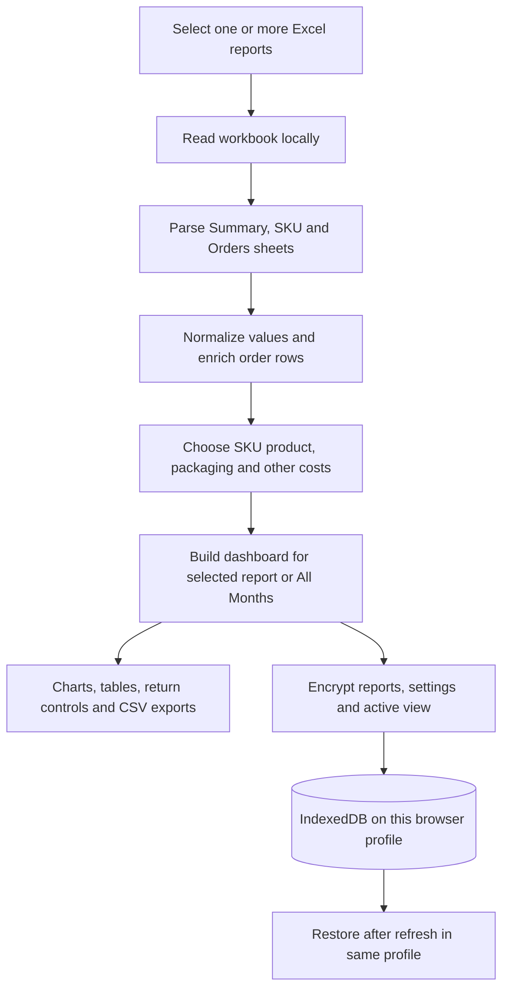
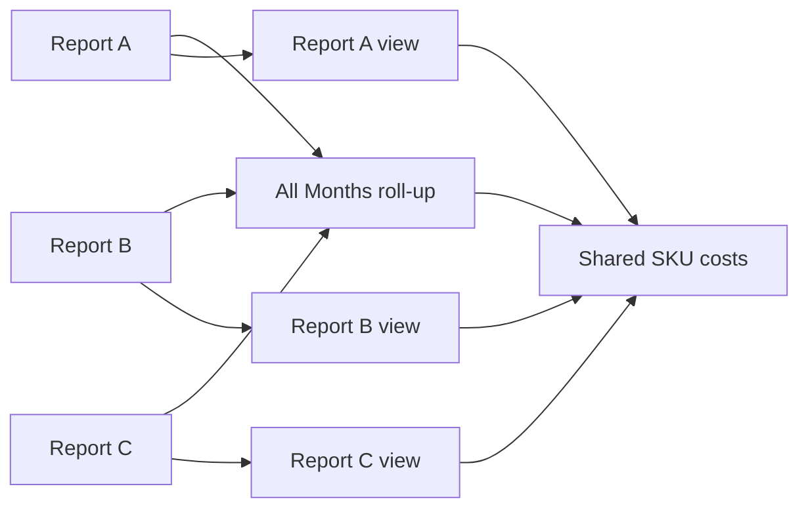
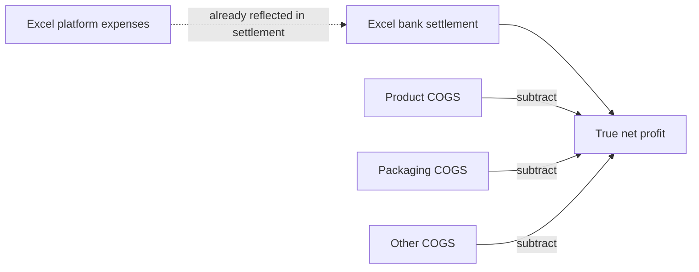
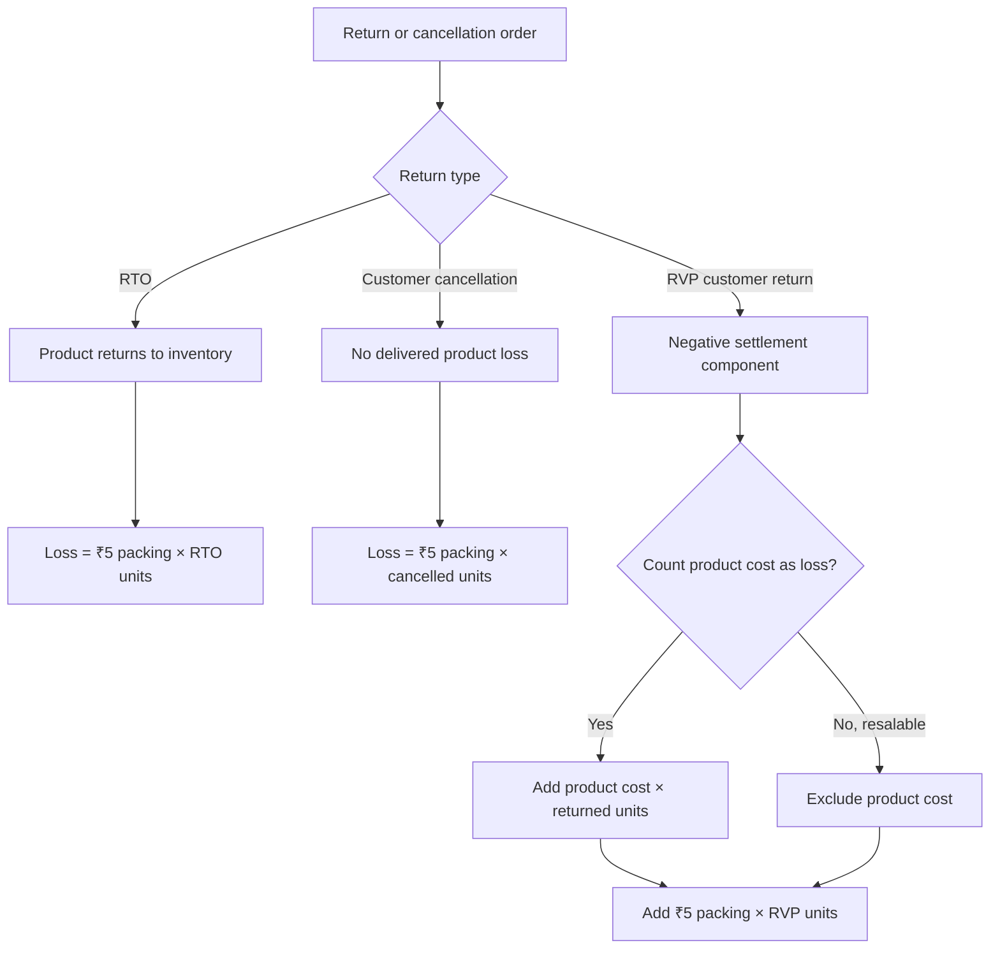
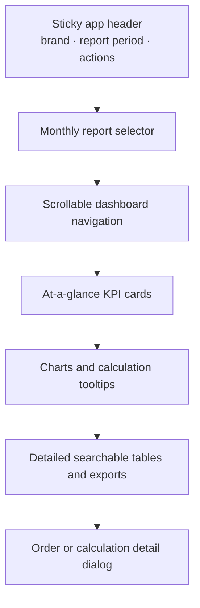
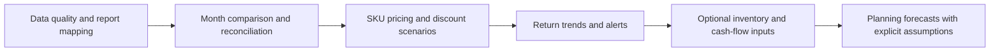

# Cladus P&L Intelligence

Cladus is a static, browser-based Flipkart report analyzer. It reads Excel reports on the user's device, calculates P&L and return metrics, and saves an encrypted workspace in that browser profile. It has no application backend, account system, sign-up, or login.

> **Financial interpretation:** Excel-reported platform expenses are already reflected in the reported bank settlement. Cladus shows platform expenses as a breakdown, but the main profit formula subtracts seller COGS from settlement only. Do not subtract platform expenses from settlement a second time.

## Contents

- [Run it](#run-it)
- [Application flow](#application-flow)
- [Data model and report handling](#data-model-and-report-handling)
- [P&L and cost calculations](#pl-and-cost-calculations)
- [Returns and loss calculations](#returns-and-loss-calculations)
- [Delivery and customer-fee analysis](#delivery-and-customer-fee-analysis)
- [Interface and visual design](#interface-and-visual-design)
- [Dashboard guide](#dashboard-guide)
- [Exports and calculation explanations](#exports-and-calculation-explanations)
- [Future opportunities](#future-opportunities)
- [Local storage and privacy](#local-storage-and-privacy)
- [Project map](#project-map)

## Run it

Open `index.html` in a modern browser, or serve this directory as a static site. The Excel parser and chart library are loaded from public CDNs, so an internet connection is required to load those libraries. A secure context (HTTPS or localhost) is required for Web Crypto encryption.

Upload one or more `.xlsx` or `.xls` Flipkart reports. Processing happens in the browser; the workbook is not sent to an application server.

## Application flow



The app's core state is held in `app.js`. `index.html` supplies the dashboard structure, and `style.css` supplies its responsive visual theme. Chart tooltips and the calculation guide describe the calculation source and, where available, sample order IDs and amounts.

## Data model and report handling

### Workbook inputs

The parser recognizes report data from:

| Sheet/data area | Used for |
|---|---|
| Summary | Reporting period, sales and units, expenses, taxes, bank settlement, and other report totals |
| SKU P&L | Per-SKU sales, units, reported expenses, reverse shipping, and settlement |
| Orders P&L | Order/item IDs, status, units, selling values, settlement, fee/tax fields, returns, and transaction details |

Column names are matched from the workbook headers. If an optional field is absent, its parsed value is zero and the app tracks field availability where that matters. Uploaded files should use the expected Flipkart report layout; check the original report when a field is missing or a reconciliation warning appears.

### Multiple reports

- Select multiple months together to create a workspace with **All Months** and one view per report.
- **Add Reports** appends reports to the current workspace. **Change Reports** starts a replacement set.
- Already-added files are checked to prevent accidentally counting the same report twice.
- Product costs are shared across report views. RVP product-loss switches are stored on their orders.
- The selected report and dashboard tab are restored with the saved session.



## P&L and cost calculations

### Seller-entered cost of goods

Each SKU has editable costs per net unit. Defaults are:

| Cost | Default per unit |
|---|---:|
| Product | ₹80 |
| Packaging | ₹5 |
| Other | ₹0 |

For each SKU:

```text
Product COGS   = net units × product cost per unit
Packaging COGS = net units × packaging cost per unit
Other COGS     = net units × other cost per unit
Total COGS     = Product COGS + Packaging COGS + Other COGS
```

Cladus uses **net units** for ordinary seller COGS. The return-specific ₹5 packing loss is a separate calculation on the Returns tab; it does not replace or silently add to ordinary COGS.

### Profit and fee treatment



```text
True Net Profit = Excel Bank Settlement − Total COGS
True Margin (%) = True Net Profit ÷ Accounted Net Sales × 100
```

The SKU view allocates shared report expenses and settlement adjustments across SKUs in proportion to accounted net sales so SKU-level results can be reconciled to the report totals. These allocations are not an extra platform-fee deduction from the overall profit formula.

The Expenses tab intentionally displays two different totals:

```text
Platform Expenses = absolute Excel Summary Total Expenses
Total Costs incl. COGS = Platform Expenses + Product COGS + Packaging COGS + Other COGS
```

**Total Costs incl. COGS is a cost summary, not another amount to subtract from settlement.** Platform fees are shown for analysis, and their impact is already present in settlement. Packaging is included once in COGS and profit.

Expense detail rows show parsed fee/tax categories and seller COGS. The reconciliation line compares the absolute reported platform-expense total to the itemized categories: an unitemized balance is shown as **Other / Unitemized Platform Expense**, and an overage is shown as a reconciliation credit. This makes gaps visible rather than silently changing the report's total.

The order detail view separates reported values (settlement, fee/tax fields, discounts, recoveries) from allocated values and seller-entered COGS. Displaying an Excel fee next to settlement does not mean that fee is deducted again.

## Returns and loss calculations

Cladus treats the return types differently because inventory recovery differs:



For an RVP order:

```text
RVP Settlement Loss = max(0, −Bank Settlement)
RVP Product Cost Loss = product cost per unit × RVP units, when enabled
RVP Packing Loss = ₹5 × RVP units
Total RVP Loss = Settlement Loss + Product Cost Loss + Packing Loss
```

For RTO and cancellation rows, the return-loss model charges ₹5 packing per unit. Product cost is not treated as lost in these return calculations. These are return-impact estimates and are separate from regular net-unit COGS.

- The master RVP switch sets product-loss treatment for all RVP orders in the selected report view.
- Each RVP order has an individual switch that can be changed after applying the master setting.
- Turning product loss off means the returned unit is treated as resalable; settlement and packing components remain.
- Changes are saved with the encrypted workspace.

Return shipping metrics have distinct denominators:

```text
Avg RVP Shipping / Order = absolute Summary reverse-shipping total ÷ RVP order rows
Avg Return Shipping / Unit (SKU) = absolute SKU reverse shipping ÷ (gross units − net units)
RVP Loss Recovery / Successful Unit = total RVP loss ÷ net successful units
```

A zero denominator produces zero. The recovery-per-unit value is a break-even allocation indicator, not an Excel fee or a guaranteed amount to charge.

## Delivery and customer-fee analysis

Only delivered order rows with positive net units are included in delivery analysis. Item rows are grouped by order ID before per-order averages are computed.

```text
Weighted Avg Selling Price / Unit
  = delivered Final Selling Price total ÷ delivered net units
  (Order Item Value is used only when Final Selling Price is unavailable)

Avg Order Item Value / Order = delivered Order Item Value total ÷ delivered order IDs
Avg Bank Settlement / Order = delivered settlement total ÷ delivered order IDs
Avg Flipkart Deductions / Order
  = (Order Item Value − Bank Settlement) total ÷ delivered order IDs
```

**Order Item Value − Bank Settlement is a settlement gap, not delivery-only cost.** It may contain forward/reverse shipping, commission, taxes, discounts, or other settlement deductions. A workbook-reported Forward Shipping field is shown separately where present; it is not guessed from the gap.

The customer-paid service-fee chart is a scenario, not report data:

```text
Estimated customer-paid amount = unique order IDs × editable fee per order
```

Editable low/high defaults are ₹5 and ₹10. The estimate is not seller revenue, not a seller expense, and is excluded from settlement and profit.

## Interface and visual design

The interface uses a dark navy base with indigo for active navigation and focus, teal for positive/action accents, and amber/red for warnings and losses. Cards use layered dark surfaces, restrained borders, and consistent rounded corners to keep dense financial tables and charts visually separated without changing their values.

| Design token | Purpose |
|---|---|
| Navy surfaces | App background, dashboard sections, cards, and table surfaces |
| Indigo | Active tab, selected report, focus indicators, and selected-state styling |
| Teal | Primary actions and positive/confirmed states |
| Amber | Cautions, estimates, and attention states |
| Red | Losses and negative values |
| Muted blue-gray | Secondary labels, helper text, and table headings |



The layout reflows to a single column on smaller screens; wide tables remain horizontally scrollable, while navigation can scroll horizontally rather than compressing every tab. Focus-visible outlines, semantic buttons, accessible labels, and reduced-motion preferences support keyboard and assistive-technology use. Visual tokens and component styles are maintained in `style.css`.

## Dashboard guide

| Tab | What it shows |
|---|---|
| Overview | Report KPIs and high-level order, sales, and status charts |
| P&L Waterfall | Report line items, deduction ledger, COGS breakdown, and profit summary |
| SKU Deep-Dive | Per-SKU units, returns, expenses, COGS, settlement, profit, and margin |
| Orders | Order-row search and filters; select a row or use its eye button for financial details |
| Returns | Return summary and separate RTO, RVP, and cancellation tables with loss switches |
| Discounts | Seller discount, customer discount, add-on, and offer-ID analysis |
| Expenses | Platform expense breakdown, COGS, selling price, settlement-gap analysis, and fee scenario |
| Settlements | Reported expected/paid/pending settlement and transaction batches |
| Local Insights | On-device observations based on the loaded reports |
| Costs | Edit product, packaging, and other per-SKU costs |

Chart hover details explain their data source and arithmetic. Long order lists show the first six examples and a subtotal for the remainder. For charts based on Summary or SKU aggregates, order rows may be references rather than the calculation source when they do not reconcile.

## Exports and calculation explanations

- The calculation guide describes the app's key formulas and accounting distinctions.
- Order, return-category, return-summary, SKU, and overall report exports provide downloadable data where offered in the UI.
- Return-category CSVs include order identifiers, units, settlement impact, product-loss setting, packing impact, total loss, and the formula used.
- Return summary CSVs contain category totals and the formulas behind them.
- Hover chart points for specific amounts and order references; use the order detail view for a full row-level financial breakdown.

## Future opportunities

The following are **ideas for future development**, not features currently promised or implemented. They are grounded in the uploaded Summary, SKU, and Orders data. Financial outputs should continue to show their source, formula, assumptions, and whether a value is reported or estimated.

### Good next additions using existing report data

| Priority | Idea | What it could show | Data needed / guardrail |
|---|---|---|---|
| High | Month-over-month comparison | Sales, net units, settlement, platform fees, COGS, profit, return rate, and shipping trends by report period | Multiple reports with comparable periods; show missing periods and avoid comparing partial months as full months |
| High | SKU profit and pricing simulator | Current profit/unit, break-even selling price, and estimated profit at a user-entered price or discount | Editable unit costs and the report's fee/settlement ratios; label projected values as estimates, not guaranteed Flipkart payouts |
| High | Return reason analysis | Rank SKUs and order groups with the highest RTO, RVP, cancellation, and reverse-shipping impact | Return-reason fields if present; if the workbook does not supply reasons, do not infer them |
| High | Settlement reconciliation workspace | Compare expected, paid, pending, and order-level transaction batches; flag unmatched or duplicate-looking references | Transaction IDs, NEFT/batch IDs, dates, and settlement amounts; never silently call a gap a loss |
| Medium | Platform fee anomaly alerts | Flag a fee or tax amount that differs materially from that SKU's or recent months' normal range | Several comparable reports and transparent thresholds; allow users to dismiss false positives |
| Medium | Discount effectiveness | Compare seller discount, accounted sales, units, and profit before/after discounts | Order-level or report-level discount coverage; correlation must not be presented as proof that a discount caused a sales change |
| Medium | Return-loss recovery targets | Show per-SKU extra margin or recovery per successful unit needed to offset RVP losses | RVP loss settings and net successful units; label as break-even planning rather than a recommended customer charge |
| Medium | Custom date and SKU filters | Recalculate KPIs, charts, and exports for selected dates, SKUs, statuses, or channels | Preserve clear filter scope and ensure every card/table uses the same filter selection |
| Medium | Exportable monthly management pack | A single downloadable CSV workbook or printable summary with assumptions, month comparison, SKU results, and return breakdown | Keep personally identifying/order details optional and user-controlled |

### Add-on data for more advanced planning

Some useful business features cannot be calculated reliably from Flipkart settlement reports alone. They would need additional user-provided data:

| Potential feature | Additional input required | Why it is not safe to guess |
|---|---|---|
| Inventory and reorder planning | Current stock, reserved stock, supplier lead time, and minimum order quantity per SKU | Sales history alone does not reveal stock on hand, purchase timing, or supplier constraints |
| Cash-flow forecast | Expected payout dates, supplier bills, operating costs, and opening cash balance | Bank settlement totals are not the same as cash balance or all future obligations |
| Tax filing support | Verified invoices, jurisdiction, applicable tax treatment, and accountant-reviewed rules | Settlement tax columns alone are not a complete tax return or legal/accounting determination |
| Product-level contribution margin | Purchase invoices, inbound freight, storage, and other landed-cost components | Editable product cost is only as accurate as the values the seller enters |
| Marketplace benchmarking | A trusted, lawful external benchmark dataset | This private workbook does not contain competitor prices or category-wide demand |

### Suggested delivery sequence



Keep the browser-only privacy model as the default. Any future sync, collaboration, or cloud-backed feature would change the privacy and security model and should be opt-in, separately documented, and designed before implementation.

## Local storage and privacy

- The app saves reports and settings in IndexedDB and encrypts the session with AES-GCM.
- A non-extractable Web Crypto key is stored locally for the browser profile. No passphrase or user account is required.
- Data is not synchronized to another device. Clearing browser site data, changing profiles, or losing the browser key can make saved reports unavailable.
- Encryption protects saved data at rest from casual inspection; it does not protect data from malicious code running in the page or someone using an unlocked browser profile.
- A static client-side app cannot conceal its delivered HTML, JavaScript, or styles from site visitors. Do not put secrets in frontend files.
- The workbook is processed locally, but the app loads parser/chart libraries from public CDNs. Those library requests do not include spreadsheet contents.
- Use the **Clear local data** control to delete the saved encrypted session from this browser.
- Do not commit seller reports, local databases, or credentials. The repository's `.gitignore` excludes common report and local-data files.

## Project map

| File | Responsibility |
|---|---|
| `index.html` | Dashboard layout, navigation, tables, and modal structure |
| `app.js` | Excel parsing, report state, formulas, chart construction, persistence, and exports |
| `style.css` | Shared colors, responsive layout, controls, tables, charts, and dashboard styling |
| `README.md` | User-facing behavior, calculation definitions, privacy notes, and architecture |
